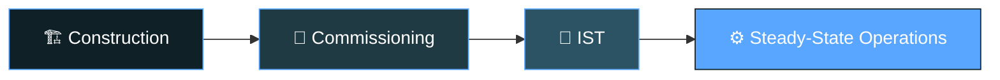
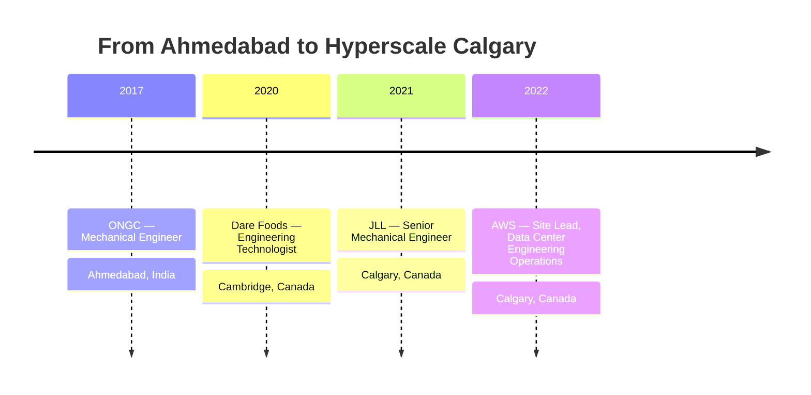

<!-- ============================================================
     Urvesh Maheshbhai Patel — GitHub profile README
     Open-source projects powering the visuals in this file:
     - Capsule Render (waving header + footer):
       https://github.com/kyechan99/capsule-render
     - readme-typing-svg (animated typing lines):
       https://github.com/DenverCoder1/readme-typing-svg
     - GitHub Stats Extended (stats card; maintained successor
       of github-readme-stats):
       https://github.com/stats-organization/github-stats-extended
     - github-readme-quotes (quote card; custom quote = his own
       motto from this profile):
       https://github.com/piyushsuthar/github-readme-quotes
     - shields.io (all badges): https://github.com/badges/shields
     - komarev profile views counter:
       https://github.com/antonkomarev/github-profile-views-counter
     Deliberately NOT used: Platane/snk contribution snake and
     yoshi389111/github-profile-3d-contrib — both render from the
     contribution grid, nearly empty for a non-coder, so they would
     spotlight the empty grid. Addable later once GitHub activity
     grows; each needs a one-time GitHub Actions workflow.
     ============================================================ -->

  

  

# Urvesh Maheshbhai Patel

### Site Lead, Data Center Engineering Operations — AWS · Calgary, Canada

  
  
  
  
  

---

## ⚡ Impact at a Glance

| 40+ MW | 3 AZs | 99.9999% | 5 facilities |
|---|---|---|---|
| Hyperscale critical environment | Availability Zones | Uptime sustained | SPOF-elimination program |
| 14 reporting engineers | 100+ engineers trained & certified | 300+ Bar Raiser interviews | 40 vendor organisations |

## 🔁 Data Centre Lifecycle

| Phase | What I own | Proof |
|---|---|---|
| **Construction** | Hyperscale build-out, MEP delivery, vendor coordination | Launched the AWS Calgary region from ground zero |
| **Commissioning** | Energization, systems readiness, handover to operations | Procedures, training & shift readiness built from scratch |
| **IST** | Integrated failure-scenario, transfer & load testing | Rack-down drills & SPOF testing across facilities |
| **Steady-State Operations** | Uptime, SPOF elimination, critical switching, incident response | 99.9999% uptime across 5 facilities · 14 engineers · 100+ trained |

**40 vendor organisations managed across the full lifecycle — from construction to steady-state operations.**

## 🗺️ My Journey

⚡ **Fun fact:** 40 MW is roughly enough electricity to power 30,000+ homes — that's the scale of critical environment I run every day.

## 👨‍💻 About Me

- 🔧 **Site Lead, Data Center Engineering Operations at AWS since July 2022** — leading a 40+ MW hyperscale critical environment across three Availability Zones in Calgary
- 🚀 Core team that **launched the AWS Calgary region from ground zero** — procedures, training, and shift readiness built from scratch
- ⚡ Program owner for **SPOF elimination, critical switching, and incident response** across five facilities, sustaining **99.9999% uptime**
- 👥 Leads a team of **14 engineers**; trained and certified **100+ engineers**; **300+ technical interviews** as a Bar Raiser
- 🤝 Works with **40 vendor organisations** across the data centre lifecycle — construction, commissioning, integrated systems testing (IST), and steady-state operations

## 🛠️ What I Do

🔍 A day in the life of a Site Lead

- **Shift readiness** — training and certifying engineers for critical operations
- **Critical switching** — planning and executing switching operations on live critical systems
- **Incident response** — owning the response when things go wrong, then driving the fix to closure
- **Vendor coordination** — 40 vendor organisations across construction, commissioning, IST and operations
- **Safety first** — 100+ safety audits tracked to closure

## 🎓 Education & Credentials

- **M.Eng., Mechanical Engineering** — University of Windsor
- **B.Eng., Mechanical Engineering** — Gujarat Technological University, 2014–2018
- **PMP** Certified · **EIT** (APEGA) · **Lean Six Sigma Green Belt**

## 📊 GitHub Stats

<!-- Stats reflect GitHub activity only — this profile leads with operations impact above, not code volume. Card served by GitHub Stats Extended, the actively maintained successor of github-readme-stats. -->

  

## 💬 Words I Work By

  

## 🎯 Currently

- 🔭 **Currently:** Site Lead, Data Center Engineering Operations, AWS — Calgary
- 🤝 **Open to:** Data centre critical infrastructure operations leadership roles — Calgary, and US roles where relocation fits
- 💬 **Ask me about:** hyperscale operations, commissioning, critical power & cooling, critical switching, incident response, reliability engineering

## 🤝 Connect With Me

---

  

